## What we do

Hiveframe Systems LLC is a Colorado Springs company that builds, hosts and manages AI agents. They work inside the systems a business already runs. We work with businesses directly and through MSPs.

An agent should answer to the same rules as an employee: who it is, what it can touch, and a record of what it did. We enforce those rules in the platform, not in the prompt.

## Governance at the core

- **Identity:** every `tools/list` and `tools/call` request carries a JWT from an identity provider. The gateway validates it every time.
- **Permissions:** roles from the identity provider decide which tools each agent can see and call. Tools are fixed in code. A prompt can't add one.
- **Human approval:** unattended agents get read-only access or writes to simple systems. Where a mistake would matter, the agent drafts and a person decides.
- **Secrets:** credentials are never stored in config or prompts.
- **Audit:** every tool call is logged with caller, time and result. Returned data is not.

## How Hiveframe works

A beehive frame is what worker bees build on. Hiveframe is that frame for agents.

- **One AWS account per customer**, built from the same tested Terraform.
- **MCP gateway** - holds the tools and enforces the rules above.
- **Agent orchestration** - runs scheduled jobs, like a nightly email brief, on Claude in Amazon Bedrock.

## Contact

Tell us which systems you'd want an agent working in.

- [hiveframesystems.com](https://hiveframesystems.com)
- [contact@hiveframesystems.com](mailto:contact@hiveframesystems.com)
